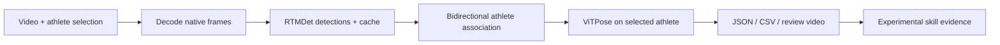

# Trampoline Pose

[](https://github.com/THOM4S05/trampoline-pose-portfolio/actions/workflows/tests.yml)

I'm building this to make trampoline videos easier to review. You pick an
athlete in a clip, and the app follows them through the routine, draws a
skeleton over the video, and saves the joint positions as JSON or CSV.

There's also a browser interface for uploading clips, choosing the athlete
and reviewing the results. I've started adding skill analysis to estimate
somersault rotation and body shape, though that part still needs work.

**This is a working prototype that I'm continuing to develop.** It can produce
useful review videos, but difficult poses can still confuse the tracker.
The [roadmap](docs/ROADMAP.md) covers what I'd like to improve next.

## Demos — Upload and analysis

See the browser interface in action:

- [Watch the upload demo](docs/assets/upload-demo.mp4)
- [Watch the analysis demo](docs/assets/analysis-demo.mp4)

These screen recordings show the prototype's upload and analysis workflow.

## Demo — Tuck back somersaults getting tighter


[Watch the demo video](docs/assets/red-tuck-backs.mp4). The skeleton comes from
the tracker's predictions on a development clip. I've cropped and resized the preview
and removed the audio and recording metadata. This is one of the clips used
during development, so it shows how the project is progressing rather than
serving as an independent accuracy test. More in the [demo notes](docs/DEMO.md).

## What it does

- Follows the selected athlete forwards and backwards through a clip, and tries
  to find them again after an occlusion. Uncertain or lost tracking is marked.
- Keeps the video's original frame timing and handles display rotation, so the
  exported coordinates and skeleton overlay line up with the source.
- Exports all 17 COCO body landmarks per frame, including the raw predictions,
  missing values and information about how each result was produced.
- Lets you upload, select, process and review clips through a private browser
  interface. Processing runs in a queue, with results saved between sessions.
- Estimates trampoline contact times, somersault rotation and body shape.
  These estimates need video review; twist estimation isn't implemented yet.

The project uses pretrained **RTMDet-tiny and ViTPose-S** models through
OpenMMLab. My focus here is on turning those models into a usable application:
keeping track of the right athlete, handling the video correctly, building the
review interface and testing the pipeline. I haven't trained a new pose model.
See [third-party attribution](THIRD_PARTY.md) for the upstream projects.

## Try it without a GPU

Requirements: **Python 3.11**, FFmpeg/ffprobe on PATH, and optionally Node.js to
run the browser logic tests. These commands use PowerShell on Windows:

```powershell
git clone https://github.com/THOM4S05/trampoline-pose-portfolio.git
cd trampoline-pose-portfolio
py -3.11 -m venv .venv
.\.venv\Scripts\python.exe -m pip install -r requirements-dev.txt
.\.venv\Scripts\python.exe examples/synthetic_demo.py
.\.venv\Scripts\python.exe -m pytest -q
node --test tests/skill_navigation.test.cjs
```

This example generates a stick figure and runs known joint coordinates through
the tracking and export code. You can try the pipeline without downloading
model weights or setting up CUDA; it doesn't run pose estimation on real footage.
The resulting video, GIF, JSON and CSV files are saved in `outputs/synthetic-demo/`.
Use FFmpeg 8.0.1 to match the tested setup; see the
[setup guide](docs/TRACKER.md#environment).

## Process your own video

I've been running the full tracker on Windows with a GTX 1070. The dependencies
are pinned for **Windows x64, Python 3.11 and CUDA 11.8**. Setup downloads
several GB of packages and model weights, and I still need to check the full
GPU setup on a second machine.

```powershell
powershell -NoProfile -ExecutionPolicy Bypass -File .\scripts\setup.ps1
.\.venv\Scripts\python.exe -m pip install -r requirements-web.txt
powershell -NoProfile -ExecutionPolicy Bypass -File .\scripts\start-portal.ps1
```

Open `http://127.0.0.1:8765` and use the generated local access key. Upload a
clip, select an exact frame, draw a box around the athlete and start processing.
The inbox is designed for a local machine or private network.

See the [browser guide](docs/VIDEO-INBOX.md) for the complete flow and
[CLI/API reference](docs/TRACKER.md) for scripted processing.

## How it works



Finding people in every frame is expensive, so the app caches those detections.
That makes it possible to adjust the athlete-tracking logic without running
the detector again. It also keeps raw predictions alongside accepted joint
positions, so there's something to inspect when a result looks wrong.

Video preparation and GPU processing share a single worker. This keeps several
uploads from trying to use the GPU at once.

## Testing and what's next

The published version passed **114 Python tests and 6 JavaScript tests** on
12 October 2026. These check things like frame timing, rotation, tracking
recovery, exports, uploads and browser controls. GitHub runs the checks on each
push; the [Actions page](https://github.com/THOM4S05/trampoline-pose-portfolio/actions)
has the latest results.

I've also run the models on real footage, including a 779-frame routine.
The harder cases are still inverted poses, limbs hidden from the camera and
keeping anatomical left and right correct. Passing software tests doesn't
tell me how accurate those predictions are, so a next step is to compare them
against independently labelled routines.

More detail is in the [validation notes](docs/VALIDATION.md) and
[skill analysis notes](docs/skill-identification-baseline.md).

For ongoing changes, see [development and publication checks](CONTRIBUTING.md).

## Repository guide

| Location | Purpose |
| --- | --- |
| `src/trampoline_pose/` | Tracking, video I/O, exports, analysis and Flask portal |
| `src/trampoline_pose/web/` | Browser interface in HTML, CSS and JavaScript |
| `tests/` | Synthetic Python integration/unit tests and browser logic tests |
| `examples/` | Python API example and reproducible synthetic demo |
| `configs/` | Tracker configuration profiles |
| `models/manifest.json` | Upstream model identifiers, URLs and checksums |
| `docs/` | Setup, usage, validation and roadmap |

## License

Original project code is available under the [MIT license](LICENSE).
External libraries, weights and datasets retain their own terms;
see [third-party attribution](THIRD_PARTY.md).
