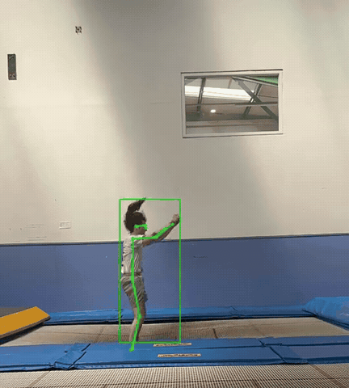
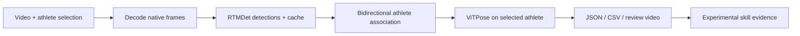

# Trampoline Pose

[](https://github.com/THOM4S05/trampoline-pose-portfolio/actions/workflows/tests.yml)

**An experimental computer-vision application for reviewing trampoline routines.**
Select an athlete in a video, track 17 body landmarks, and export a skeleton
review video plus timestamped JSON and CSV. A private browser inbox handles
uploads, athlete selection, background processing and experimental skill analysis.

**Status:** working prototype, actively developed. Pose accuracy and skill
estimates still need independent labelled evaluation. See the [roadmap](docs/ROADMAP.md).

## Demo — RedTuckBacks



[Watch the demo video](docs/assets/red-tuck-backs.mp4). This is an actual
tracking output from the RedTuckBacks development clip. The preview is cropped
and resized for presentation, with audio and metadata removed. It illustrates
current behaviour on one clip, not general pose or skill-classification accuracy.
See [demo details](docs/DEMO.md).

## What the project implements

- **Athlete tracking:** forwards and backwards from a selected frame, with motion,
  appearance and scale checks, explicit uncertain/lost states, and reacquisition.
- **Video correctness:** native presentation timestamps, display rotation, mapped
  crop coordinates, streaming processing and matching overlay timing.
- **Reviewable outputs:** all 17 COCO joints per frame, raw predictions, explicit
  missing values, diagnostics, provenance and JSON schema validation.
- **Browser workflow:** chunked uploads, exact-frame selection, a single processing
  queue, restart recovery and authenticated downloads.
- **Experimental analysis:** contact proxies, projected somersault rotation and
  body-shape evidence, with reasons to review uncertain results. Twist is deferred.

The pretrained detector and pose estimator are **RTMDet-tiny and ViTPose-S**,
accessed through OpenMMLab. The project work is the tracking, video pipeline,
application, analysis heuristics and validation around those models; it does
not include training a new pose model. See [third-party attribution](THIRD_PARTY.md).

## Try the pipeline without a GPU

Requirements: **Python 3.11**, FFmpeg/ffprobe on PATH, and optionally Node.js to
run the browser logic tests. These commands use PowerShell on Windows:

```powershell
git clone https://github.com/THOM4S05/trampoline-pose-portfolio.git
cd trampoline-pose-portfolio
py -3.11 -m venv .venv
.\.venv\Scripts\python.exe -m pip install -r requirements-dev.txt
.\.venv\Scripts\python.exe examples/synthetic_demo.py
.\.venv\Scripts\python.exe -m pytest -q
node --test tests/skill_navigation.test.cjs
```

The synthetic example writes `source.mp4`, `overlay.mp4`, `preview.gif`,
`joints.json` and `joints.csv` under `outputs/synthetic-demo/`. It uses generated
coordinates and an injected backend, so no weights, CUDA or athlete recordings
are needed. It demonstrates export behaviour, not model inference. Install
FFmpeg 8.0.1 for the tested codec suite; see [setup](docs/TRACKER.md#environment).

## Process your own video

The full inference environment is pinned for **Windows x64, Python 3.11 and
CUDA 11.8**, developed on a GTX 1070. Setup downloads several GB of dependencies
and model weights. A clean second-machine GPU setup remains unverified.

```powershell
powershell -NoProfile -ExecutionPolicy Bypass -File .\scripts\setup.ps1
.\.venv\Scripts\python.exe -m pip install -r requirements-web.txt
powershell -NoProfile -ExecutionPolicy Bypass -File .\scripts\start-portal.ps1
```

Open `http://127.0.0.1:8765` and use the generated local access key. Upload a
clip, select an exact frame, draw a box around the athlete and start processing.
The inbox is designed for a local machine or private network.

See the [browser guide](docs/VIDEO-INBOX.md) for the complete flow and
[CLI/API reference](docs/TRACKER.md) for scripted processing.

## Design



Detection caching allows association changes to be reviewed without repeating
expensive detection. Separate raw and accepted coordinates preserve evidence
when a prediction is missing or uncertain. The portal serializes preparation
and GPU work through one worker to bound concurrent resource use.

## Validation and next steps

The local suite passed **114 Python tests and 6 JavaScript tests** on
12 October 2026. It covers timing, rotation, association, recovery, exports,
request validation, video codecs and analysis/navigation behaviour. The
[Actions page](https://github.com/THOM4S05/trampoline-pose-portfolio/actions) shows CI results.

Real GPU runs have been exercised locally, including a 779-frame development
routine. Those development runs do not establish general accuracy. Inverted
poses, occlusion and anatomical left/right identity remain difficult. See
[validation evidence and limitations](docs/VALIDATION.md) and the
[analysis method](docs/skill-identification-baseline.md).

Next priorities are a clean GPU installation check and an independently labelled
evaluation set. Development continues in this repository; the current
implementation is intentionally presented as a prototype.

For ongoing changes, see [development and publication checks](CONTRIBUTING.md).

## Repository guide

| Location | Purpose |
| --- | --- |
| `src/trampoline_pose/` | Tracking, video I/O, exports, analysis and Flask portal |
| `src/trampoline_pose/web/` | Browser interface in HTML, CSS and JavaScript |
| `tests/` | Synthetic Python integration/unit tests and browser logic tests |
| `examples/` | Python API example and reproducible synthetic demo |
| `configs/` | Tracker configuration profiles |
| `models/manifest.json` | Upstream model identifiers, URLs and checksums |
| `docs/` | Setup, usage, validation and roadmap |

## License

Original project code is available under the [MIT license](LICENSE).
External libraries, weights and datasets retain their own terms;
see [third-party attribution](THIRD_PARTY.md).
